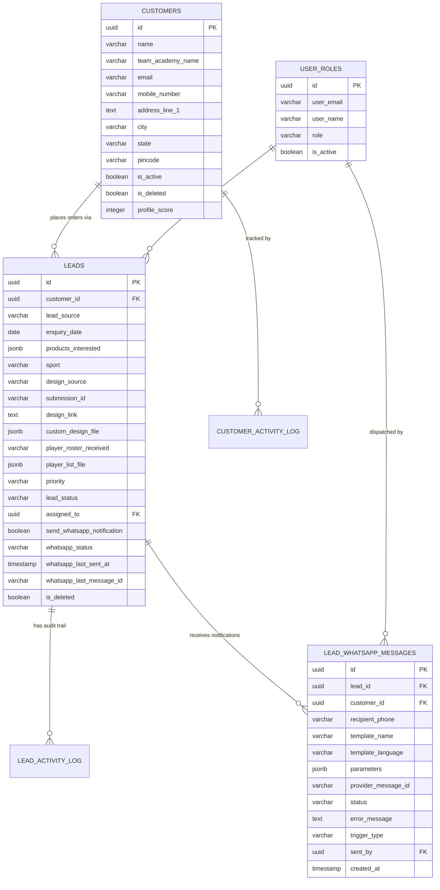

# Ira Sportswear — Customer Workflow Management System (CWFMS)
## Comprehensive Technical & Architectural Documentation

---

### 1. Project Overview

The **Ira Sportswear Customer Workflow Management System (CWFMS)** is a specialized CRM and manufacturing pipeline tracking application designed to handle customized sportswear team orders from initial inquiry to final factory dispatch. It automates lead assignment, customer profile management, sports order lifecycle tracking, WhatsApp customer notifications, and team permissions across the sales and management hierarchy.

---

### 2. Technology Stack

- **Backend Runtime**: PHP 8.1+ (compatible with PHP 8.2 and 8.3)
- **Web Server**: Apache 2.4+ (with `mod_rewrite`, `mod_headers`, `mod_deflate`, `mod_expires`)
- **Database & Identity**: Supabase / PostgreSQL 15+ (PostgREST API v1)
- **External Communications**: Meta WhatsApp Cloud API (Graph API v21.0)
- **Frontend Architecture**: Server-rendered PHP, Vanilla JavaScript (ES6+), Modern Responsive CSS3 (CSS Variables, Flexbox, CSS Grid)
- **Animations & Icons**: GSAP 3.12+ (GreenSock), SVG Iconography
- **Testing Engine**: Standalone PHP CLI Verification & Regression Test Suites

---

### 3. System Architecture

```
                    ┌────────────────────────────────────────────────────────┐
                    │               Client Browser / Frontend                │
                    │   (Kanban Board, Table View, Calendar, Lead Modals)    │
                    └───────────────────────────┬────────────────────────────┘
                                                │ HTTPS / REST / JSON
                                                ▼
                    ┌────────────────────────────────────────────────────────┐
                    │             Apache Web Server / PHP 8.x                │
                    │  ├── Middleware (Auth Guards, Role Normalization, CSRF)│
                    │  ├── Service Layer (WhatsAppService, Activity Logger)  │
                    │  └── API Controllers (leads.php, auth.php, etc.)       │
                    └───────────────┬────────────────────────┬───────────────┘
                                    │                        │
         PostgREST HTTPS API Key    │                        │  Graph API v21.0
                                    ▼                        ▼
     ┌──────────────────────────────────────────┐  ┌──────────────────────────────────┐
     │          Supabase / PostgreSQL           │  │     Meta WhatsApp Cloud API      │
     │  ├── customers & activity logs           │  │  ├── Approved Templates          │
     │  ├── leads & lead_activity_log           │  │  └── Delivery Status Webhooks    │
     │  ├── user_roles & RLS policies           │  └──────────────────────────────────┘
     │  └── lead_whatsapp_messages audit log    │
     └──────────────────────────────────────────┘
```

---

### 4. Main Modules

1. **Authentication & Access Control (`login.php`, `api/auth.php`)**:
   Session-based authentication with strict business role enforcement (`admin`, `sales_manager`, `sales_executive`), account deactivation, and self-modification blocks.
2. **Customer Management (`api/customers.php`, `pages/customer-detail.php`)**:
   Relational customer registry capturing club/academy name, primary contact person, validated mobile number, full address, active status, and automated profile completeness scoring (0–100%).
3. **Lead Management Module (`pages/leads.php`, `api/leads.php`)**:
   Central pipeline supporting Kanban board view, Table view with multi-select bulk operations, and Calendar scheduling view.
4. **WhatsApp Communication & Webhooks (`includes/whatsapp.php`, `api/whatsapp_webhook.php`, `api/whatsapp.php`)**:
   Meta Cloud API messaging integration with dynamic template generation, delivery status tracking, and automated workflow triggers.
5. **System User Management (`pages/users.php`, `api/auth.php`)**:
   Administrative user interface for managing team members, assigning business roles, and controlling system access.

---

### 5. Ten-Stage Lead Workflow

The system enforces the official 10-stage order progression defined in the Ira Sportswear specification:

| Stage # | Stage Name | Business Description | Automated Trigger |
|:---:|---|---|---|
| **1** | `Received` | Initial inquiry logged from Kit Builder, Website, WhatsApp, or Email. | `ira_lead_acknowledgement` |
| **2** | `Analysis` | Sales team reviews kit design, sport requirements, and roster viability. | Activity log recorded |
| **3** | `Awaiting Clarification` | On hold pending player roster details, vector logos, or sizing confirmation. | `ira_clarification_request` |
| **4** | `Order Sheet Prepared` | Sales rep finalizes bill of materials, product breakdown, and pricing. | `ira_order_sheet_update` |
| **5** | `Verified` | Manager / Technical Lead verifies artwork vector formats and order quantities. | Activity log recorded |
| **6** | `Awaiting Approval` | Quotation and proof sent to client for sign-off. | Activity log recorded |
| **7** | `Approved` | Client formally approves proof, roster, and quotation. | `ira_order_approved` |
| **8** | `Awaiting Payment` | Pro-forma invoice issued; awaiting advance deposit. | Activity log recorded |
| **9** | `Moved to Production` | Transferred to factory floor for sublimation printing, cutting, and stitching. | `ira_moved_to_production` |
| **10** | `Lost` | Inquiry cancelled, competitor chosen, or non-responsive. Requires mandatory reason. | Activity log recorded |

---

### 6. Database Tables & Entity Relationships



---

### 7. API Endpoint Overview

| Endpoint | Method | Action | Auth / Permission | Description |
|---|:---:|---|:---:|---|
| `/api/auth.php` | `GET` | `action=me` | Session | Returns current authenticated user & business role. |
| `/api/auth.php` | `GET` | `action=users` | Admin only | Returns team members and assigned roles. |
| `/api/auth.php` | `POST` | `action=update_role` | Admin only | Updates a user's role (self-edit blocked). |
| `/api/leads.php` | `GET` | *(default)* | Authenticated | Returns leads filtered by search, sport, rep, dates. |
| `/api/leads.php` | `GET` | `action=customers-list` | Authenticated | Returns active customers for dropdown selector. |
| `/api/leads.php` | `POST` | *(default)* | Authenticated | Creates a lead with mandatory customer association. |
| `/api/leads.php` | `PUT` | *(default)* | Edit Permitted | Updates lead details, customer, and priority. |
| `/api/leads.php` | `PATCH` | *(default)* | Change Status | Transitions workflow stage with activity logging. |
| `/api/leads.php` | `POST` | `action=bulk_update` | Role Permitted | Performs batch status update, reassign, or delete. |
| `/api/leads.php` | `DELETE` | `id={uuid}` | Admin only | Performs safe soft deletion of a lead record. |
| `/api/whatsapp.php` | `GET` | `action=templates` | Authenticated | Lists approved templates and parameter schemas. |
| `/api/whatsapp.php` | `GET` | `action=history` | Permitted Rep | Returns audit trail of sent messages for a lead. |
| `/api/whatsapp.php` | `POST` | `action=send` | Permitted Rep | Dispatches manual template notification via Meta API. |
| `/api/whatsapp_webhook.php` | `GET` | *(Meta challenge)* | Public / Token | Verifies webhook subscription with Meta. |
| `/api/whatsapp_webhook.php` | `POST` | *(Status event)* | HMAC SHA256 | Ingests real-time message delivery statuses. |

---

### 8. Role & Permission Matrix

| Capability / Action | Admin | Sales Manager | Sales Executive |
|---|:---:|:---:|:---:|
| **View Leads** | All Leads | All Leads | Assigned Leads |
| **Create Lead** | Allowed | Allowed | Allowed (Auto self-assigned) |
| **Assign / Reassign Lead** | Allowed | Allowed | Denied (HTTP 403) |
| **Edit Lead Details** | All Leads | All Leads | Assigned Leads Only |
| **Transition Lead Status** | All Stages | All Stages | Allowed Stages on Assigned |
| **Delete Lead** | Allowed (Soft Delete) | Denied (HTTP 403) | Denied (HTTP 403) |
| **Bulk Status Update** | Allowed | Allowed | Denied (HTTP 403) |
| **Bulk Reassignment** | Allowed | Allowed | Denied (HTTP 403) |
| **Bulk Lead Deletion** | Allowed | Denied (HTTP 403) | Denied (HTTP 403) |
| **User Management** | Full Access | Denied (HTTP 403) | Denied (HTTP 403) |
| **Export to CSV** | All Leads | All Leads | Assigned Leads |
| **Manual WhatsApp Send** | All Leads | All Leads | Assigned Leads Only |

---

### 9. WhatsApp Integration Architecture

The integration complies strictly with Meta WhatsApp Cloud API standards:
1. **Phone Number Normalization**: Automatically normalizes input numbers to ITU E.164 standard (e.g., `+91 9876543210` $\to$ `919876543210`).
2. **Approved Templates**:
   - `ira_lead_acknowledgement`
   - `ira_clarification_request`
   - `ira_order_sheet_update`
   - `ira_order_approved`
   - `ira_moved_to_production`
3. **Delivery Lifecycle**:
   `requested` $\longrightarrow$ `sent` $\longrightarrow$ `delivered` $\longrightarrow$ `read` (or `failed`)
4. **Idempotent Webhook Processing**:
   Updates are guarded by state precedence ranks. Delayed or out-of-order webhook events cannot downgrade a message status (e.g., late `delivered` event will not overwrite `read`).
5. **Non-Blocking Resilience**:
   All automation hooks in `api/leads.php` are wrapped in non-blocking exception handlers. If Meta's API is temporarily unreachable, CRM updates succeed smoothly while logging the delivery issue.

---

### 10. Installation Instructions

1. **Prerequisites**:
   - Web server with PHP 8.1+ and cURL, OpenSSL, PDO/PostgreSQL extensions.
   - Supabase project or PostgreSQL 15+ database instance.
2. **Clone & Setup Directory**:
   Place the `cwfms` directory inside your web server document root (e.g., `C:/xampp/htdocs/cwfms` or `/var/www/html/cwfms`).
3. **Environment Configuration**:
   Copy `.env.example` to `.env`:
   ```bash
   cp .env.example .env
   ```
   Populate credentials as explained in Section 11.

---

### 11. Environment Configuration

```ini
# Application Mode
APP_ENV=production

# Supabase REST Configuration
SUPABASE_URL=https://your-project.supabase.co
SUPABASE_ANON_KEY=your-supabase-anon-key
SUPABASE_SERVICE_KEY=your-supabase-service-role-key

# Meta WhatsApp Cloud API Configuration
WHATSAPP_API_VERSION=v21.0
WHATSAPP_TOKEN=your_meta_system_user_access_token
WHATSAPP_PHONE_NUMBER_ID=your_phone_number_id
WHATSAPP_BUSINESS_ACCOUNT_ID=your_waba_id
WHATSAPP_WEBHOOK_VERIFY_TOKEN=your_custom_verify_token
WHATSAPP_APP_SECRET=your_meta_app_secret
WHATSAPP_AUTOMATIONS_ENABLED=true
WHATSAPP_AUTOMATION_STAGES=Received,Awaiting Clarification,Approved,Moved to Production
```

---

### 12. Safe Migration Execution Order

Execute the SQL migration scripts in this exact sequence via the Supabase SQL Editor:

1. [`supabase_setup.sql`](file:///c:/Users/Selvakumar/OneDrive/Desktop/studio3/cwfms/supabase_setup.sql) — Initializes core tables (`customers`, `user_roles`, `leads`, `lead_activity_log`, views, RLS).
2. [`migration_v2.sql`](file:///c:/Users/Selvakumar/OneDrive/Desktop/studio3/cwfms/migration_v2.sql) — Adds profile scoring trigger and `is_active` customer flags.
3. [`migration_v3_leads.sql`](file:///c:/Users/Selvakumar/OneDrive/Desktop/studio3/cwfms/migration_v3_leads.sql) — Adds `priority` column (`low`, `medium`, `high`) and relational indexes.
4. [`migration_v4_roles.sql`](file:///c:/Users/Selvakumar/OneDrive/Desktop/studio3/cwfms/migration_v4_roles.sql) — Expands role constraints to support `sales_manager` and `sales_executive`.
5. [`migration_v6_whatsapp.sql`](file:///c:/Users/Selvakumar/OneDrive/Desktop/studio3/cwfms/migration_v6_whatsapp.sql) — Creates `lead_whatsapp_messages` audit log table and tracking columns.

*All migrations are 100% idempotent and can be safely re-run without data loss.*

---

### 13. Testing Instructions

Run the full automated regression and end-to-end verification suite from the terminal:

```bash
# Execute full suite across all 6 phases and E2E scenarios
php cwfms/tests/phase1_test.php
php cwfms/tests/phase2_test.php
php cwfms/tests/phase3_test.php
php cwfms/tests/phase4_test.php
php cwfms/tests/phase5_test.php
php cwfms/tests/phase6_test.php
php cwfms/tests/e2e_final_audit_test.php
```

All 300 tests must pass with 100% success rate.

---

### 14. Deployment Instructions

1. Ensure the web server has `mod_rewrite` and `mod_headers` enabled.
2. Verify that `cwfms/.htaccess` and `cwfms/uploads/.htaccess` are active.
3. Configure SSL/TLS certificate for HTTPS termination.
4. Set file permissions on `cwfms/uploads/leads` to `0775` (writable by web server process).
5. In Supabase, verify that Row-Level Security (RLS) is enabled and service-role keys are guarded.
6. In Meta Developer Console, subscribe the webhook endpoint to `messages` event field.

---

### 15. Known Limitations

- **Meta Account Verification**: Live WhatsApp message delivery requires an active Meta Business verification and registered template approval in WhatsApp Manager.
- **Client-Side Theme Persistence**: Dark/light theme preferences are stored in browser `localStorage`.
- **Large File Attachments**: Lead attachments are currently constrained to 10 MB per file.
